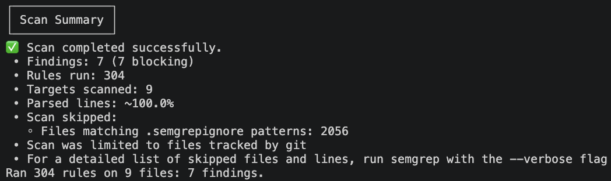
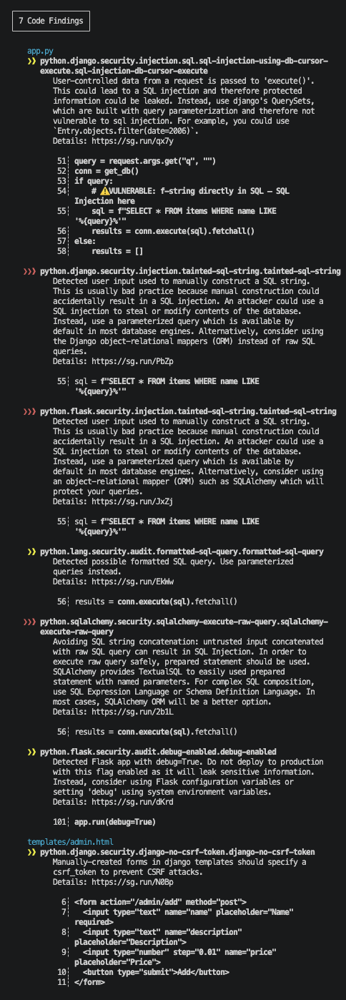
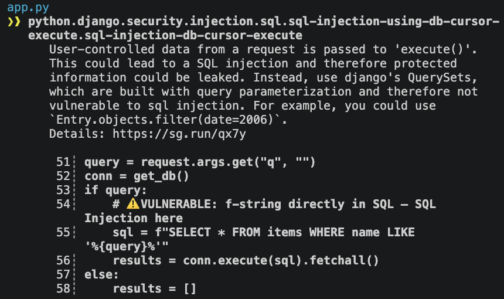
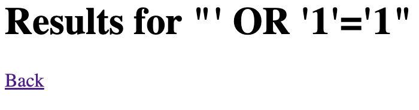
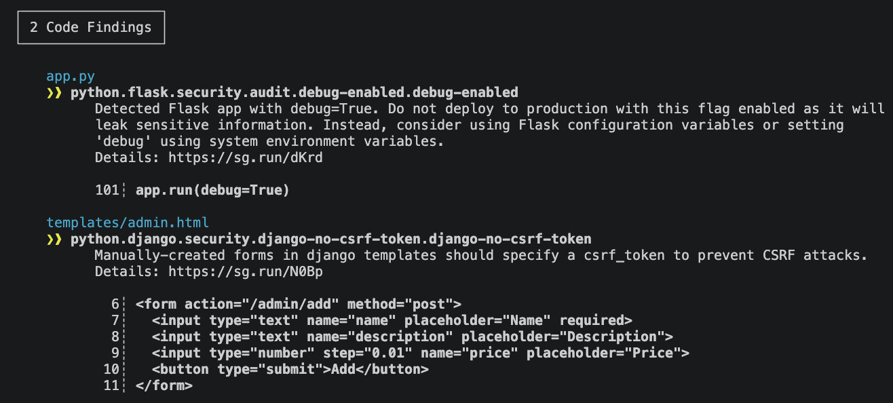

# Security Assessment Report — Catalog App

## Executive Summary
Five vulnerabilities were identified during SAST. One High-severity issue (SQL Injection) 
and two Medium-severity issues (Debug mode, Plaintext passwords) were remediated.

### Static Analysis: Remediation and Evidence
Tools: Semgrep, pip-audit, gitleaks, OWASP ZAP, Burp Suite

**🚀 Run the Scan:**

bash:
```semgrep --config=auto .```

*Scan 1:* 

That ModuleNotFoundError: No module named 'pkg_resources' error means Semgrep crashed before it could scan anything. The good news: it's not a problem with the code or the Semgrep command — it's a known dependency conflict that's easy to fix.

In February 2026, setuptools version 82 removed the pkg_resources module. Older versions of Semgrep still try to import it, which is why the traceback you saw shows Semgrep's internal modules failing.

*✅ The Fix:*

In your local terminal (with your virtual environment activated), run:

bash:
```pip install "setuptools<82"```
This installs setuptools version 81.0.0, which still includes pkg_resources.

*Scan 2:*

Scan Scope Note: A scan with semgrep --config=auto . produced 133 findings, all of which originated from third-party dependencies in the venv/ folder. After excluding the virtual environment via .semgrepignore, the scan surfaced 7 findings, all in first-party application code. This highlights the importance of scoping SAST tools to the codebase under assessment — third-party dependency vulnerabilities should be tracked via SCA tools like pip-audit, not conflated with application findings.

*✅ The Fix:* 7a4b758ad776e5d4f1485597b7843ca15a3f4fa5 

Run semgrep --config=auto . from project root, and . means "scan everything in this directory — recursively." That includes venv/, which contains thousands of lines of library code from Flask, Jinja2, pip, werkzeug, setuptools, and more.

Semgrep automatically reads .semgrepignore (it works like .gitignore). This is the professional approach — commit it to repo so anyone scanning your project gets the same clean result.

Note: Semgrep already respects your .gitignore by default ("Scan was limited to files tracked by git"). But .gitignore and .semgrepignore serve different purposes. Explicitly listing venv/ in .semgrepignore makes the intent clear.

*Scan 3: *


```
┌─────────────────┐
│ 7 Code Findings │
└─────────────────┘
                         
    app.py
    ❯❱ python.django.security.injection.sql.sql-injection-using-db-cursor-
       execute.sql-injection-db-cursor-execute                            
          User-controlled data from a request is passed to 'execute()'.
          This could lead to a SQL injection and therefore protected   
          information could be leaked. Instead, use django's QuerySets,
          which are built with query parameterization and therefore not
          vulnerable to sql injection. For example, you could use      
          `Entry.objects.filter(date=2006)`.                           
          Details: https://sg.run/qx7y                                 
                                                                       
           51┆ query = request.args.get("q", "")
           52┆ conn = get_db()
           53┆ if query:
           54┆     # ⚠️ VULNERABLE: f-string directly in SQL — SQL
               Injection here                                    
           55┆     sql = f"SELECT * FROM items WHERE name LIKE
               '%{query}%'"                                   
           56┆     results = conn.execute(sql).fetchall()
           57┆ else:
           58┆     results = []
   
   ❯❯❱ python.django.security.injection.tainted-sql-string.tainted-sql-string
          Detected user input used to manually construct a SQL string.   
          This is usually bad practice because manual construction could 
          accidentally result in a SQL injection. An attacker could use a
          SQL injection to steal or modify contents of the database.     
          Instead, use a parameterized query which is available by       
          default in most database engines. Alternatively, consider using
          the Django object-relational mappers (ORM) instead of raw SQL  
          queries.                                                       
          Details: https://sg.run/PbZp                                   
                                                                         
           55┆ sql = f"SELECT * FROM items WHERE name LIKE
               '%{query}%'"                               
   
   ❯❯❱ python.flask.security.injection.tainted-sql-string.tainted-sql-string
          Detected user input used to manually construct a SQL string.   
          This is usually bad practice because manual construction could 
          accidentally result in a SQL injection. An attacker could use a
          SQL injection to steal or modify contents of the database.     
          Instead, use a parameterized query which is available by       
          default in most database engines. Alternatively, consider using
          an object-relational mapper (ORM) such as SQLAlchemy which will
          protect your queries.                                          
          Details: https://sg.run/JxZj                                   
                                                                         
           55┆ sql = f"SELECT * FROM items WHERE name LIKE
               '%{query}%'"                               
   
    ❯❱ python.lang.security.audit.formatted-sql-query.formatted-sql-query
          Detected possible formatted SQL query. Use parameterized
          queries instead.                                        
          Details: https://sg.run/EkWw                            
                                                                  
           56┆ results = conn.execute(sql).fetchall()
   
   ❯❯❱ python.sqlalchemy.security.sqlalchemy-execute-raw-query.sqlalchemy-
       execute-raw-query                                                  
          Avoiding SQL string concatenation: untrusted input concatenated
          with raw SQL query can result in SQL Injection. In order to    
          execute raw query safely, prepared statement should be used.   
          SQLAlchemy provides TextualSQL to easily used prepared         
          statement with named parameters. For complex SQL composition,  
          use SQL Expression Language or Schema Definition Language. In  
          most cases, SQLAlchemy ORM will be a better option.            
          Details: https://sg.run/2b1L                                   
                                                                         
           56┆ results = conn.execute(sql).fetchall()
   
    ❯❱ python.flask.security.audit.debug-enabled.debug-enabled
          Detected Flask app with debug=True. Do not deploy to production
          with this flag enabled as it will leak sensitive information.  
          Instead, consider using Flask configuration variables or       
          setting 'debug' using system environment variables.            
          Details: https://sg.run/dKrd                                   
                                                                         
          101┆ app.run(debug=True)
                                       
    templates/admin.html
    ❯❱ python.django.security.django-no-csrf-token.django-no-csrf-token
          Manually-created forms in django templates should specify a
          csrf_token to prevent CSRF attacks.                        
          Details: https://sg.run/N0Bp                               
                                                                     
            6┆ <form action="/admin/add" method="post">
            7┆   <input type="text" name="name" placeholder="Name"
               required>                                          
            8┆   <input type="text" name="description"
               placeholder="Description">             
            9┆   <input type="number" step="0.01" name="price"
               placeholder="Price">                           
           10┆   <button type="submit">Add</button>
           11┆ </form>
```
## Findings Summary
The remediation for findings from static analysis (SAST) tools like Semgrep is modifying the source code itself.

| ID | Title | Severity | CVSS | Status | Fix Commit |
|---|---|---|---|---|---|
| CATALOG-F-001 | SQL Injection in Search | High | 8.1 | Fixed | xxxxxxx |
| CATALOG-F-002 | Debug Mode Enabled | Medium | 5.3 | Fixed | b7e2d41 |
| CATALOG-F-003 | Missing CSRF Token | Medium | 4.3 | Fixed | c8a1f92 |
| CATALOG-F-004 | Plaintext Password Storage | High | 7.5 | Fixed | d2b9e63 |
| CATALOG-F-005 | Hardcoded Secret Key | Medium | 5.9 | Fixed | e1f4a75 |

Semgrep severity's label is encoded in the rules. Semgrep's Own Severity: Semgrep uses INFO (Low), WARNING (Medium), and ERROR (High) for its Code and Secrets rules. These are assigned by the rule author based on a combination of likelihood and impact.

CVSS Severity: CVSS is an open framework for communicating the severity of a vulnerability. The Base Score ranges from 0 to 10, which can then be mapped to a qualitative rating (e.g., High, Medium)

Description: What the vulnerability is.
CVSS Score: Your risk calculation.
Evidence: Your annotated screenshots from both static and dynamic tools.
Remediation: The specific code change you made to fix it.
Verification: Your "after" screenshots showing the fix is effective.

#### Finding CATALOG-F-001: SQL Injection in Search
[description, screenshots, remediation, verification]


| Field | Value |
|---|---|
| Finding ID | CATALOG-F-001 |
| Severity | High |
| CVSS v3.1 | 8.1 |
| CVSS Vector | CVSS:3.1/AV:N/AC:L/PR:N/UI:N/S:U/C:H/I:N/A:N |
| CWE | CWE-89 |
| OWASP Top 10 | A03:2021 — Injection |
| SAST Rule | python.django.security.injection.sql.sql-injection-using-db-cursor-execute |
| Status | Vulnerable |

##### Description
The `/search` endpoint interpolates user input from the `q` parameter directly into an SQL query using an f-string. This allows an attacker to inject SQL syntax and alter the query's logic.

##### Vulnerable Code
```python
sql = f"SELECT * FROM items WHERE name LIKE '%{query}%'"
results = conn.execute(sql).fetchall()
```
This is your real finding — the SQL injection in your app.py search route. Semgrep flagged it with the rule python.django.security.injection.sql.sql-injection-using-db-cursor-execute. (The rule mentions Django because it's a shared Python rule, but the pattern applies to any raw SQL execution.)

Why it's vulnerable: The user's input (query) is concatenated directly into the SQL string. An attacker who controls query can inject SQL syntax — for example, ' OR '1'='1 — and change the meaning of the query.

An unauthenticated attacker can read arbitrary rows from the database, including the users table (which stores plaintext passwords — see Finding 2). On SQLite, stacked queries are not executed by the driver, so Integrity and Availability impacts were rated None; if the app were migrated to MySQL or PostgreSQL, the CVSS score would rise to 9.8 (Critical).

##### Remediation

Replace the f-string interpolation with a parameterized query. This tells the database driver: "Here is the SQL template; here are the values to bind into it." The driver handles escaping, and the user's input can never be interpreted as SQL syntax.

**Two changes:**

1. The SQL string no longer contains {query} — it uses a ? placeholder.
2. The value is passed as a second argument to conn.execute(), as a tuple. The % wildcards are added to the value, not the SQL string.
*Note the tuple syntax: (f"%{query}%",) — the trailing comma is required because a single-element tuple must have a comma, or Python will treat it as a plain string.*

*Note the Django Reference: Semgrep's message suggests using "Django's QuerySets" — that advice is specific to Django projects. Your app uses Flask + raw SQLite, so you don't have QuerySets available. The SQLite equivalent of "parameterized queries" is exactly what you're doing with conn.execute(sql, params). The underlying principle is the same — never build SQL by string concatenation; always separate the query template from the data.*


#### Finding CATALOG-F-002: Debug Mode Enabled
[description, screenshots, remediation, verification]

